  <picture>
    <source media="(prefers-color-scheme: dark)" srcset="./assests/dark.svg">
    
  </picture>

<!--Snake-->
<picture>
  <source media="(prefers-color-scheme: dark)" srcset="https://raw.githubusercontent.com/juniorhillory-creator/juniorhillory-creator/output/github-contribution-grid-snake-dark.sv">
  <source media="(prefers-color-scheme: light)" srcset="https://raw.githubusercontent.com/juniorhillory-creator/juniorhillory-creator/output/github-contribution-grid-snake.svg">
  <!---->
</picture>

<!--**juniorhillory-creator/juniorhillory-creator** is a ✨ _special_ ✨ repository because its `README.md` (this file) appears on your GitHub profile.-->

<!---->
